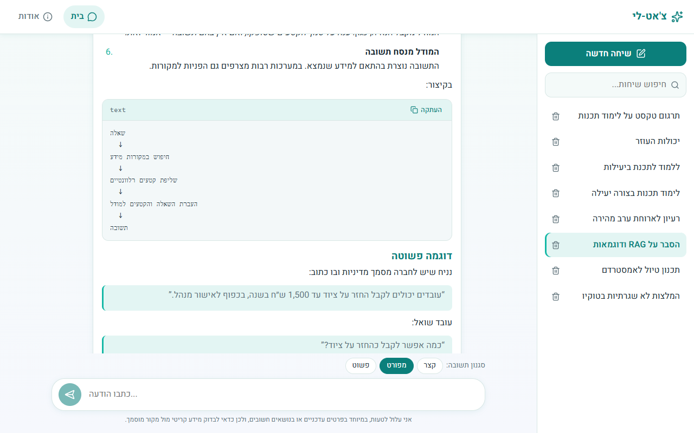
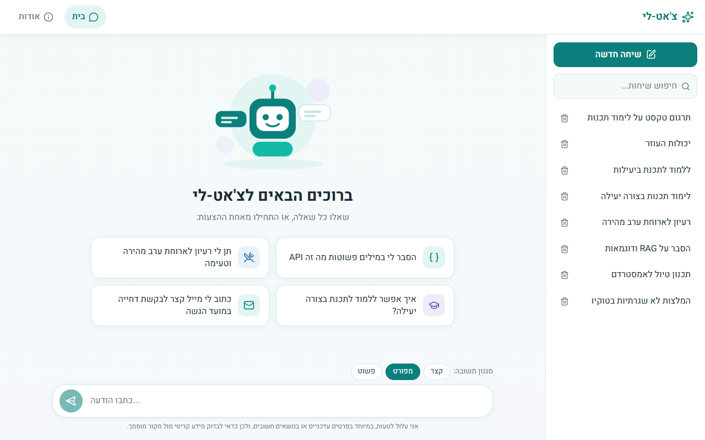
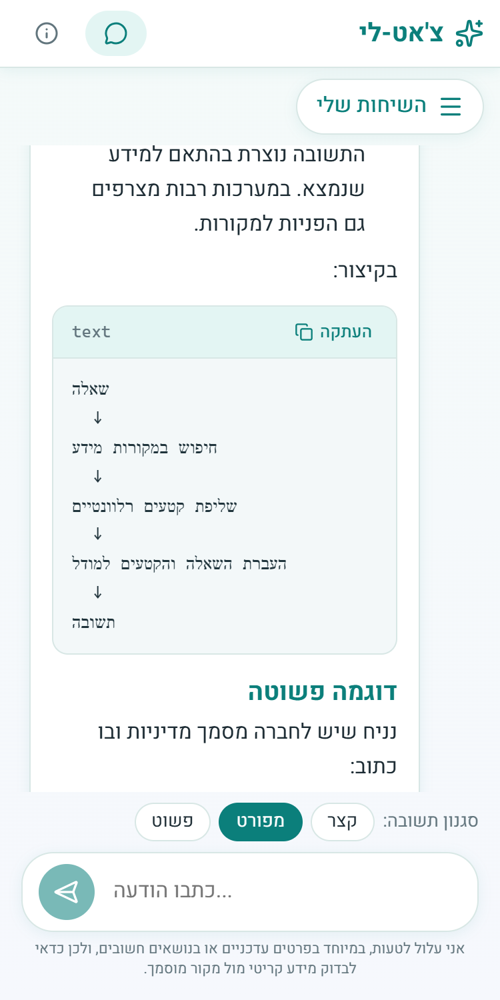
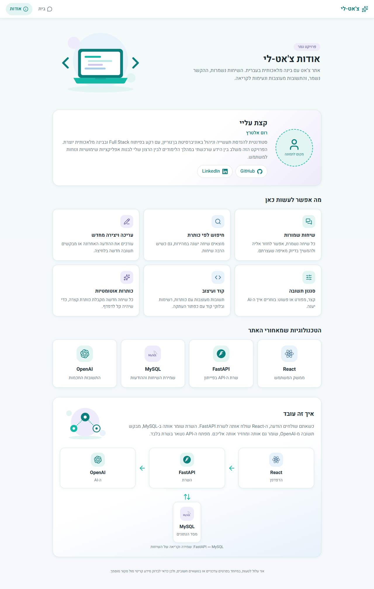

# צ'אט-לי — Hebrew AI Chat

A ChatGPT-style chat website with a complete Hebrew, right-to-left interface, built with React, FastAPI, MySQL and the OpenAI API.
Final project for the **Full Stack & Gen AI** course at John Bryce, by Rom Altaraz.

**GitHub repository:** https://github.com/romaltaraz/AI-agent



## Features

- Chat with an AI assistant; every conversation is saved in MySQL and continues with its previous context.
- Sidebar with all saved conversations (newest activity first), search by title, and delete with a confirmation dialog.
- Edit the latest user message, regenerate the latest answer, and **retry** when an AI request failed. No message is ever duplicated or lost.
- Choose a response style per conversation: short, detailed, or simple.
- Automatic short Hebrew title for each new conversation.
- AI answers are rendered as Markdown. Every paragraph and list item gets its own text direction, and code blocks are left-to-right with a copy button.
- Responsive layout (the sidebar becomes a drawer on phones) and a designed About page.

| Welcome screen | Mobile | About page |
|---|---|---|
|  |  |  |

## Tech stack

| Part | Technology |
|---|---|
| Frontend | React (Vite), react-router-dom, react-markdown, lucide-react, plain CSS |
| Backend | Python, FastAPI, Pydantic, `openai`, `mysql-connector-python`, `python-dotenv` |
| Database | MySQL 8 (plain parameterized SQL, no ORM) |
| AI | OpenAI API, called **only** from the backend. The key lives in `Backend/.env` |

## Project structure

```
Backend/              FastAPI app, Dockerfile, postman_collection.json
Frontend/             React app, Dockerfile
Database/             schema.sql (structure only) and ai_chat_export.sql (structure + sample data)
docs/screenshots/     Pictures used in this README
docker-compose.yml    mysql + backend + frontend, started with one command
AGENTS.md             Short guide for AI coding agents
```

## Quick start with Docker

You need **Docker** and an **OpenAI API key**. Nothing else.

1. Create your settings file:
   ```
   copy Backend\.env.example Backend\.env        (macOS/Linux: cp Backend/.env.example Backend/.env)
   ```
2. In `Backend/.env`, set `OPENAI_API_KEY` and `OPENAI_MODEL` (a model your account can use; the project was built with `gpt-6-luna`).
3. Start everything:
   ```
   docker compose up --build
   ```
4. Open http://localhost:5173.

**One settings file for both ways of running.** You only ever fill in `Backend/.env`. Docker Compose reads it (`env_file`) and then replaces the database settings (`DB_HOST`, `DB_PORT`, `DB_USER`, `DB_PASSWORD`, `DB_NAME`) and `FRONTEND_ORIGIN` with the values for its own MySQL container. So the `DB_*` lines in that file only matter for the manual setup below (the Compose MySQL on 3307), and you don't have to change them for Docker.

**Ports:** the app is on 5173, the API on 8000 (docs at http://localhost:8000/docs), and the Compose MySQL is on **3307** on your computer (used by Docker and by the manual setup below).

**Sample data:** on the very first start, MySQL loads `Database/ai_chat_export.sql` automatically, so you see 8 sample conversations. This happens **only once**, while the database volume is empty. Later starts keep your data (including your own new chats) and do not reload the sample file.

**Reset the database:** `docker compose down -v` stops everything and deletes the database volume. The next `docker compose up` loads the sample data again. (`docker compose down` without `-v` keeps your data.)

## Manual setup

You need: **Python 3.14** (what it was tested with), **Node.js 24**, **Docker**, and an **OpenAI API key**.

### 1. Database

Start the MySQL from Docker Compose (it listens on port **3307**, and loads the sample data automatically on the first start):

```
docker compose up -d mysql
```

Have your own MySQL server instead? Change `DB_HOST`/`DB_PORT`/`DB_PASSWORD` in `Backend/.env` and import `Database/schema.sql` (empty) or `Database/ai_chat_export.sql` (sample data) yourself.

### 2. Backend

```
cd Backend
python -m venv venv
venv\Scripts\activate            (macOS/Linux: source venv/bin/activate)
pip install -r requirements.txt
copy .env.example .env           (macOS/Linux: cp .env.example .env)
```

Open `Backend/.env` and set `OPENAI_API_KEY` and `OPENAI_MODEL`. Then start the server:

```
uvicorn main:app --reload
```

Check it at http://localhost:8000/api/health. You should see `{"status":"ok","database":"connected"}`.
The interactive API docs are at http://localhost:8000/docs.

### 3. Frontend

In a second terminal:

```
cd Frontend
npm install
npm run dev
```

Open http://localhost:5173.

## Environment variables (`Backend/.env`)

| Variable | Meaning |
|---|---|
| `DB_HOST`, `DB_PORT`, `DB_USER`, `DB_PASSWORD`, `DB_NAME` | MySQL connection for the manual setup. Defaults point to the Compose MySQL (`localhost`, port `3307`, password `change_me`). Full Docker (`docker compose up`) overrides all of these |
| `FRONTEND_ORIGIN` | The only origin allowed by CORS (default `http://localhost:5173`) |
| `OPENAI_API_KEY` | Your OpenAI key. Never commit it; `.env` is in `.gitignore` |
| `OPENAI_MODEL` | The model name used for answers and titles |

## API

| Method | Path | Purpose |
|---|---|---|
| GET | `/api/health` | Server and database check |
| GET | `/api/conversations?search=` | List conversations that have messages, newest first |
| POST | `/api/conversations` | Create a conversation (optional `response_style`) |
| GET | `/api/conversations/{id}` | Conversation with all its messages |
| PATCH | `/api/conversations/{id}` | Change the response style |
| DELETE | `/api/conversations/{id}` | Delete a conversation and its messages |
| POST | `/api/conversations/{id}/messages` | Send a message and get the AI reply |
| POST | `/api/conversations/{id}/regenerate` | Regenerate the latest answer, or retry a failed one |
| PUT | `/api/conversations/{id}/messages/last` | Edit the latest user message and get a new answer |

A ready-made **Postman collection** with an example and an automatic status test for every endpoint is in
`Backend/postman_collection.json`. Import it and run the collection in order (the first create request saves the conversation id for the rest).

## How the important parts work

- **Context:** each AI request sends a short system instruction, the style instruction, and the latest 30 messages of *that* conversation only.
- **Failure rule:** a user message is saved *before* the AI is called. If the AI fails, the conversation ends with a user message and no answer. The **retry** button recovers from that state.
- **Regenerate:** the new answer is generated first. The old answer is deleted only after the new one succeeded.
- **Titles:** generated once, after the first reply. If that request fails, the beginning of the first message is used.

## Customizing

- App name and the small "I may make mistakes" note: `APP_NAME` and `DISCLAIMER_TEXT` in `Frontend/src/config.js`.
- About page details and links: `PROFILE` at the top of `Frontend/src/components/about/AboutMeCard.jsx`.
- Illustrations: `Frontend/src/assets/illustrations/`.

## Credits

Illustrations are original simple SVGs made for this project. Brand logos from [Simple Icons](https://simpleicons.org) (CC0); the names and logos belong to their owners.
Icons from [Lucide](https://lucide.dev). Font: Heebo (Google Fonts).
